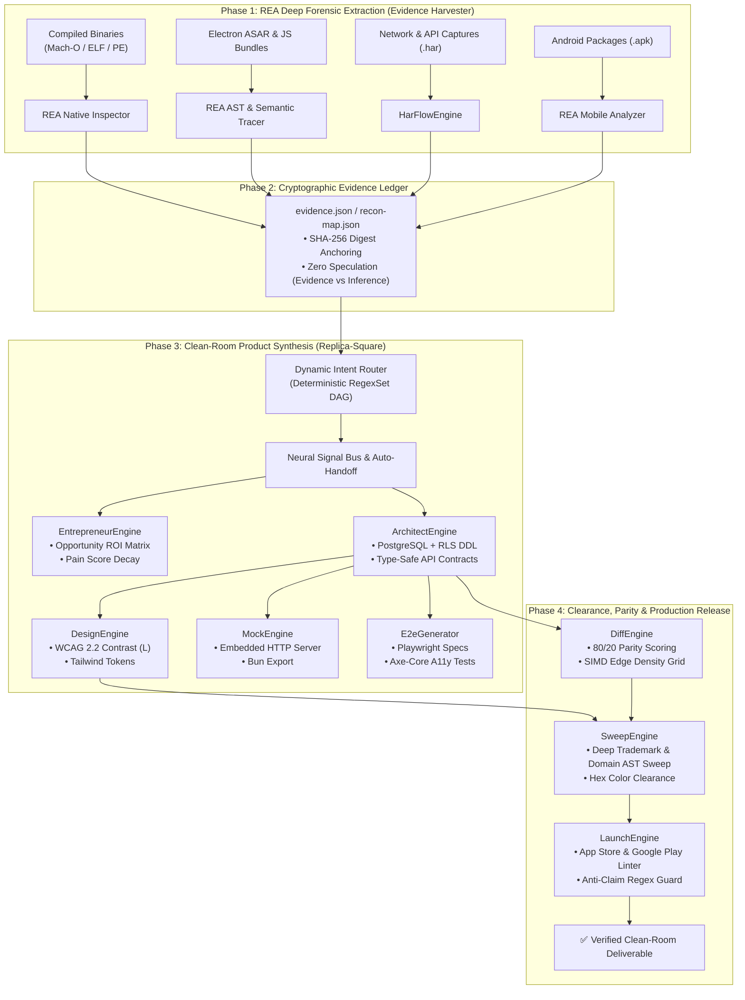

# Replica Square: Autonomous Reverse-Engineering Architecture & Clean-Room Reconstruction System

[](https://github.com/imMamdouhaboammar/replica-square/actions/workflows/ci.yml)
[](https://www.rust-lang.org/)
[](LICENSE)
[](https://modelcontextprotocol.io/)
[](https://www.w3.org/WAI/standards-guidelines/wcag/)
[](skills/rea/SKILL.md)

> **Replica Square** is a unified, autonomous software reverse-engineering and clean-room reconstruction platform. It combines **REA** (Reverse Engineer Anything) deep forensic extraction with **Replica-Square** agentic clean-room synthesis into a single cohesive system running on native Rust with **Model Context Protocol (MCP)** stdio integration.

---

## 🏛️ Unified System Architecture: REA + Replica-Square

Replica Square implements an autonomous 4-phase pipeline connecting deep forensic extraction to production-grade clean-room delivery:



---

## ⚡ The Ten Tool-Agents

| Agent | Subcommand | Playbook | Purpose |
|:---|:---|:---|:---|
| **recon** | `replica-square recon` | [`skills/replica-square/playbooks/recon.md`](skills/replica-square/playbooks/recon.md) | Maps screens, flows, and creates cryptographic SHA-256 evidence ledger |
| **har** | `replica-square har` | [`skills/replica-square/playbooks/har.md`](skills/replica-square/playbooks/har.md) | Parses network archives to extract endpoints, auth tokens, and JSON schemas |
| **entrepreneur** | `replica-square entrepreneur` | [`skills/replica-square/playbooks/entrepreneur.md`](skills/replica-square/playbooks/entrepreneur.md) | Analyzes reviews, scores user grievances, and computes Day-1 Opportunity ROI Matrix |
| **architect** | `replica-square architect` | [`skills/replica-square/playbooks/architect.md`](skills/replica-square/playbooks/architect.md) | Synthesizes PostgreSQL schema with Row-Level Security (RLS) & REST contracts |
| **design** | `replica-square design` | [`skills/replica-square/playbooks/design.md`](skills/replica-square/playbooks/design.md) | Validates WCAG 2.2 relative luminance contrast ($L$) and exports Tailwind tokens |
| **diff** | `replica-square diff` | [`skills/replica-square/playbooks/diff.md`](skills/replica-square/playbooks/diff.md) | Evaluates 80/20 functional feature parity and SIMD edge-density layout parity |
| **sweep** | `replica-square sweep` | [`skills/replica-square/playbooks/sweep.md`](skills/replica-square/playbooks/sweep.md) | Recursively sweeps AST and codebase for competitor brand names, domains, and hex colors |
| **launch** | `replica-square launch` | [`skills/replica-square/playbooks/launch.md`](skills/replica-square/playbooks/launch.md) | Audits App Store and Google Play metadata against policy and misleading claim rules |
| **mock** | `replica-square mock` | [`skills/replica-square/playbooks/mock.md`](skills/replica-square/playbooks/mock.md) | Autonomous embedded HTTP mock server and Bun runner for zero-dependency local testing |
| **test-gen** | `replica-square test-gen` | [`skills/replica-square/playbooks/test-gen.md`](skills/replica-square/playbooks/test-gen.md) | Synthesizes automated Playwright E2E journeys and Axe-Core accessibility test suites |

---

## 🛠️ Installation & Quick Start

### Build Native Engine
```bash
# Clone and build optimized release binary
git clone https://github.com/imMamdouhaboammar/replica-square.git
cd replica-square
cargo build --release

# The compiled binary is located at target/release/replica-square
./target/release/replica-square --help
```

### Dynamic Routing & Autonomous Execution
```bash
# Classify natural language intent into an execution DAG
./target/release/replica-square route "Clone Calendly and check parity at 85%"

# Execute complete autonomous pipeline with neural auto-handoff
./target/release/replica-square run --prompt "Build a full clean-room clone of Calendly"
```

### Standard Pipeline
```bash
./target/release/replica-square run \
  --target "Calendly" \
  --url https://calendly.com \
  --fail-under 80
```

---

## 🔌 Model Context Protocol (MCP) Integration

Replica Square includes a native **Model Context Protocol (MCP)** server over `stdio` conforming to JSON-RPC 2.0. Any AI client (Gemini CLI, Claude Code, Cursor, Antigravity) can orchestrate tools natively.

Add to your `claude_desktop_config.json` or `.gemini/config/mcp/servers.json`:

```json
{
  "mcpServers": {
    "replica-square": {
      "command": "/absolute/path/to/replica-square/target/release/replica-square",
      "args": ["mcp"]
    }
  }
}
```

### Exposed MCP Tools

1. `replica_route`: Analyzes natural language prompt and compiles execution DAG.
2. `replica_orchestrate`: Runs dynamic multi-agent DAG with neural bus and auto-handoff.
3. `replica_recon`: Harvests artifacts, computes SHA-256 hashes, and maps screens/flows.
4. `replica_architect`: Generates production PostgreSQL schemas with RLS and REST contracts.
5. `replica_design`: Validates WCAG 2.2 color contrast ratios and exports Tailwind CSS tokens.
6. `replica_entrepreneur`: Mines customer reviews, computes pain weights, and ranks Day-1 ROI.
7. `replica_diff`: Calculates functional feature parity and visual similarity (0-100%).
8. `replica_brand_sweep`: Scans codebase for competitor brand names, domains, and hex colors.
9. `replica_launch_audit`: Lints store listing metadata against Apple and Google policies.

---

## 🧪 Verification & Deterministic Test Suite

Run the full test pyramid:
```bash
cargo test
```

All 39 automated tests verify:
- Exact WCAG 2.2 relative luminance and contrast calculations.
- Weighted feature parity scoring with exclusion of skip/custom extensions.
- Recursive trademark clean-room sweep with false-positive prevention.
- Apple App Store & Google Play metadata bounds and anti-claim regexes.
- Cryptographic SHA-256 evidence integrity and REA compliance.
- PostgreSQL DDL generation with RLS security policies.
- HAR network traffic parsing, endpoint extraction, and JSON schema inference.
- Autonomous embedded HTTP mock server and Bun runner generation.
- Playwright E2E test spec generation with AxeBuilder accessibility assertions.
- Dynamic RegexSet router intent classification and DAG scheduling.
- Neural graph signal propagation, warning passthroughs, and Fable circuit breaker.

---

## 📜 Three Constitutional Invariants

1. **Clean-Room Invariant**: Never copy proprietary source code, trademarks, visual assets, or confidential APIs. Inspect observable behavior and public contracts exclusively.
2. **Evidence-First Invariant**: Every architectural claim cites a verifiable SHA-256 digest, public URL, or network capture. Speculation is strictly separated from evidence.
3. **Gate-Must-Pass Invariant**: Downstream releases are strictly blocked if feature parity is below the threshold, any brand violation exists, or store listing errors remain.

---

## 📄 License

MIT License. Clean-room reverse engineering respects software functionality, user interaction patterns, and public contracts, without reproducing proprietary source code or assets.
