# Replica Square: Autonomous Agentic Clean-Room Reconstruction Engine

[](https://www.rust-lang.org/)
[](LICENSE)
[](https://modelcontextprotocol.io/)
[](https://www.w3.org/WAI/standards-guidelines/wcag/)

> **Replica Square** is a production-grade, autonomous clean-room reverse-engineering and software reconstruction platform. It unifies the philosophies of **REA** (Reverse Engineer Anything), **Craft Anything**, **Fable**, and **Poteto Mode** into a high-performance native Rust engine with native **Model Context Protocol (MCP)** integration.

---

## ⚡ Evolution: Beyond Legacy Prompt Skills

The original [`jakeschincariol/replica-skill`](https://github.com/jakeschincariol/replica-skill) introduced 11 valuable conceptual workflows for cloning applications cleanly. However, it was strictly a passive collection of markdown prompts with toy Python scripts relying on standard-library image decompression and manual operator execution.

**Replica Square** transforms this paradigm into a **fully agentic, autonomous engine**:

| Capability | Legacy `replica-skill` | **Replica Square (`replica-agent`)** |
|:---|:---|:---|
| **Execution Model** | Passive markdown prompt copies | **Autonomous Rust engine + CLI + MCP stdio server** |
| **Evidence Ledger** | Non-existent (assumed memory) | **Cryptographic SHA-256 evidence anchoring (REA spec)** |
| **Parity Diffing** | Slow single-threaded Python PNG math | **SIMD-accelerated edge density grid comparison** |
| **Schema Generation** | Generic prompt instructions | **Automated PostgreSQL DDL with UUID, RLS & B-Tree indexes** |
| **Accessibility (WCAG)** | Basic script | **WCAG 2.2 Relative Luminance ($L$) & automated token export** |
| **Market Grievance Mining**| Basic CSV string matching | **Weighted Bayesian complaint ranker with age-decay scoring** |
| **Trademark Clearance** | Naive keyword grep | **Deep AST/identifier/file sweep with clean-room certificate** |
| **AI Protocol** | None (chat-only) | **Native JSON-RPC 2.0 Model Context Protocol (MCP)** |

---

## 🏛️ System Architecture

```mermaid
flowchart LR
    subgraph INGRESS ["Target Ingestion"]
        T_URL["Web / API Surface"]
        T_BIN["Binary / ASAR / APK"]
        T_REV["Market Reviews (CSV/API)"]
    end

    subgraph ENGINE ["Replica Native Core Engine (Rust)"]
        RECON["ReconEngine<br/>• SHA-256 Digesting<br/>• Surface Mapping"]
        ENTREPRENEUR["EntrepreneurEngine<br/>• Grievance Scoring<br/>• Counter-Strategies"]
        ARCHITECT["ArchitectEngine<br/>• PostgreSQL + RLS DDL<br/>• API Contracts"]
        DESIGN["DesignEngine<br/>• WCAG 2.2 Formulas<br/>• Tailwind Compiler"]
        DIFF["DiffEngine<br/>• 80/20 Parity Math<br/>• SIMD Edge Density"]
        BRAND["BrandEngine<br/>• Deep AST & Hex Sweeper<br/>• Clean-Room Audit"]
        LAUNCH["LaunchEngine<br/>• App Store Metadata Linter<br/>• Anti-Claim Guard"]
    end

    subgraph INTERFACES ["Agent & User Interfaces"]
        CLI["Standalone CLI<br/>(replica-agent)"]
        MCP["MCP Server<br/>(stdio JSON-RPC)"]
        AI["AI Agents<br/>(Gemini, Claude, Antigravity)"]
    end

    INGRESS --> ENGINE
    ENGINE --> INTERFACES
```



---

## 🛠️ Installation & Quick Start

### Build Native Engine
```bash
# Clone and build optimized release binary
git clone https://github.com/imMamdouhaboammar/replica-square.git
cd replica-square
cargo build --release

# The compiled binary is located at target/release/replica-agent
./target/release/replica-agent --help
```

### Run Full Autonomous Reconstruction
```bash
./target/release/replica-agent run \
  --target Calendly \
  --url https://calendly.com \
  --fail-under 80
```

---

## 🔌 Connecting as an MCP Server

Replica Square includes a native **Model Context Protocol (MCP)** server over `stdio`. Any AI agent (Gemini CLI, Claude Code, Cursor, Antigravity) can call its tools directly.

Add to your `claude_desktop_config.json` or `.gemini/config/mcp/servers.json`:

```json
{
  "mcpServers": {
    "replica-agent": {
      "command": "/absolute/path/to/replica-square/target/release/replica-agent",
      "args": ["mcp"]
    }
  }
}
```

### Available MCP Tools

1. `replica_recon`: Harvests artifacts, computes cryptographic hashes, and maps target screens/flows.
2. `replica_architect`: Generates production PostgreSQL schemas with RLS security policies and API contracts.
3. `replica_design`: Validates WCAG 2.2 color contrast ratios and exports Tailwind CSS tokens.
4. `replica_entrepreneur`: Mines customer reviews, computes pain weights, and formulates competitive counters.
5. `replica_diff`: Calculates functional parity and layout similarity (0-100%).
6. `replica_brand_sweep`: Scans codebase for competitor brand names, domains, and hex colors.
7. `replica_launch_audit`: Lints store listing metadata against Apple and Google policies.

---

## 🧪 Verification & Tests

Run the deterministic test suite:
```bash
cargo test
```

All 7 test suites verify:
- Exact WCAG 2.2 relative luminance and contrast calculations.
- Weighted feature parity scoring with exclusion of skip/custom extensions.
- Recursive trademark clean-room sweep with false-positive prevention.
- Apple App Store & Google Play metadata bounds and anti-claim regexes.
- Cryptographic SHA-256 evidence integrity.
- PostgreSQL DDL generation with RLS security rules.

---

## 📜 License

MIT License. Clean-room reverse engineering respects software functionality, user interaction patterns, and public contracts, without reproducing proprietary source code or assets.
