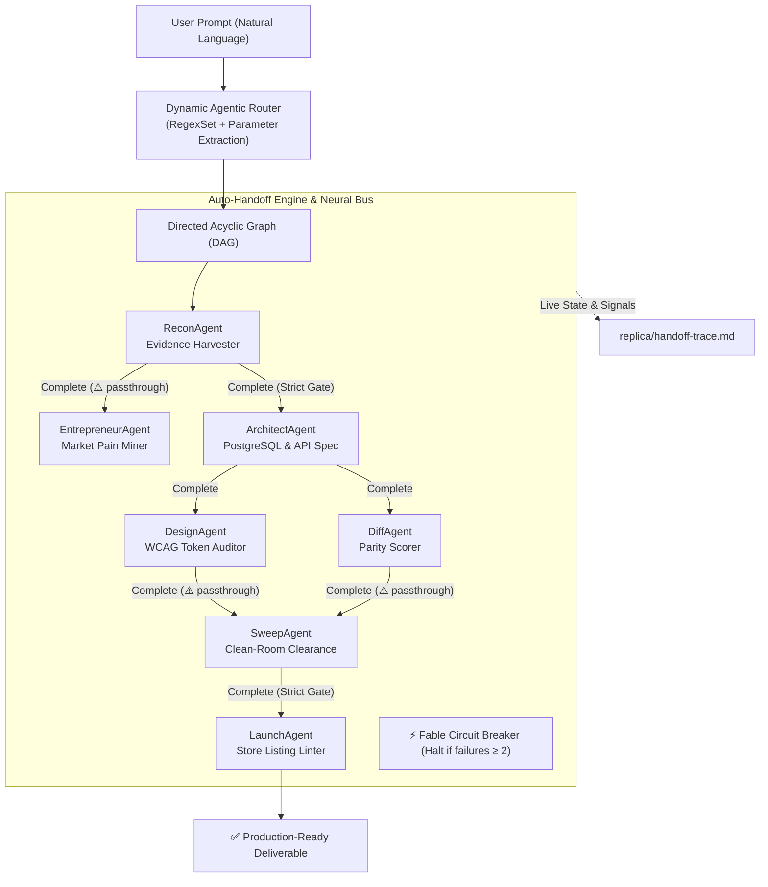

# Replica-Square: Fully Agentic Clean-Room Reconstruction Engine

> Point it at any app or natural language prompt. It dynamically routes intent, harvests verifiable evidence, plans a clean-room rebuild via autonomous tool-agents, propagates signals across a neural graph, and auto-handoffs across gates — autonomously.

---

## Dynamic Agentic Routing & Auto-Handoff Invariant

$$\text{Intent (Any Prompt)} \xrightarrow{\text{Dynamic Router}} \text{Execution DAG} \xrightarrow{\text{Tool-Agents}} \text{Neural Signal Bus} \xrightarrow{\text{Auto-Handoff}} \text{Production Release}$$

---

## The Seven Tool-Agents

| Agent | CLI | Playbook | What it does |
|:---|:---|:---|:---|
| **recon** | `replica-square recon` | [`skills/replica-square/playbooks/recon.md`](skills/replica-square/playbooks/recon.md) | Maps screens, flows, data model, and cryptographic evidence ledger |
| **entrepreneur** | `replica-square entrepreneur` | [`skills/replica-square/playbooks/entrepreneur.md`](skills/replica-square/playbooks/entrepreneur.md) | Mines user pain, ranks themes, formulates counter-features |
| **architect** | `replica-square architect` | [`skills/replica-square/playbooks/architect.md`](skills/replica-square/playbooks/architect.md) | Synthesizes PostgreSQL schema, API contracts, build order |
| **design** | `replica-square design` | [`skills/replica-square/playbooks/design.md`](skills/replica-square/playbooks/design.md) | WCAG 2.2 color validation, Tailwind token export |
| **diff** | `replica-square diff` | [`skills/replica-square/playbooks/diff.md`](skills/replica-square/playbooks/diff.md) | 80/20 feature-visual parity scoring |
| **sweep** | `replica-square sweep` | [`skills/replica-square/playbooks/sweep.md`](skills/replica-square/playbooks/sweep.md) | Trademark, domain, and hex-color clean-room sweep |
| **launch** | `replica-square launch` | [`skills/replica-square/playbooks/launch.md`](skills/replica-square/playbooks/launch.md) | App Store and Google Play metadata linter |

---

## Neural Connections & Auto-Handoff Architecture



---

## Quick Start

### 1. Dynamic Routing & Autonomous Execution
```bash
# Analyze prompt and inspect execution DAG
replica-square route "Clone Calendly and check parity at 85%"

# Run autonomous pipeline with dynamic routing and auto-handoff
replica-square run --prompt "Build a full clean-room clone of Calendly"
```

### 2. Standard Pipeline
```bash
replica-square run --target "Calendly" --url https://calendly.com --fail-under 80
```

### 3. Model Context Protocol (MCP) Server
```bash
replica-square mcp
```
