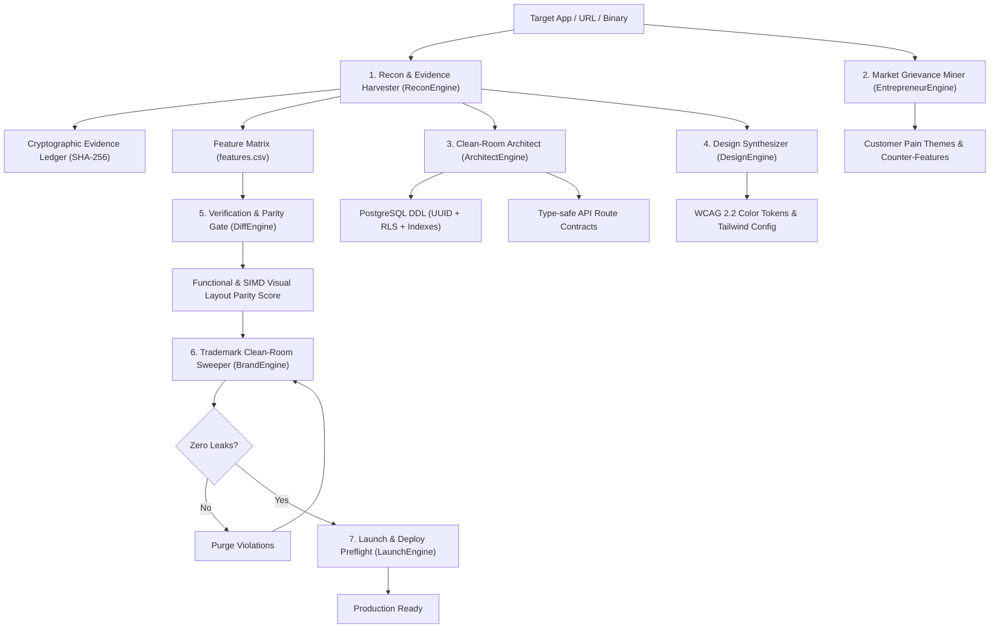

# Replica Agent: Autonomous Clean-Room Reconstruction Engine

Replica Agent is a production-grade, autonomous clean-room reverse engineering and software reconstruction platform. Unlike passive markdown-prompt collections, Replica Agent executes as a high-performance native Rust engine with built-in Model Context Protocol (MCP) server support, cryptographic evidence ledgers, and deterministic verification gates.

## Core Invariants

1. **Clean-Room Invariant**:
   Never copy proprietary source code, copyrighted assets, logos, trademarks, or private API endpoints. Reconstruct strictly from observable behavior, external API contracts, and user interaction flows.
2. **Cryptographic Evidence Ledger**:
   Every architectural claim must cite a concrete evidence digest (SHA-256 hash, URL provenance, or DOM/network trace).
3. **80/20 Parity Model**:
   Overall Parity Index is mathematically balanced:
   $$\text{Parity} = 0.8 \times \text{Feature Parity} + 0.2 \times \text{Visual Layout Parity}$$
   Features (what users actually pay for) dictate functional readiness.
4. **WCAG 2.2 Strict Accessibility**:
   All color tokens are verified against mathematical relative luminance thresholds (AA $\ge$ 4.5:1, AAA $\ge$ 7.0:1).
5. **Zero Trademark Leakage (Sweep Gate)**:
   Preflight deployment strictly halts if competitor brand names, domains, or trademark colors exist in shipping code.

---

## Autonomous Pipeline Stages



---

## CLI Commands

```bash
# Full end-to-end autonomous reconstruction pipeline
replica-agent run --target Calendly --url https://calendly.com --fail-under 80

# Harvest evidence and generate surface map
replica-agent recon https://target.app --out replica/

# Synthesize PostgreSQL schema with RLS and API routes
replica-agent architect replica/recon-map.json

# Validate WCAG 2.2 color contrast and export Tailwind tokens
replica-agent design replica/tokens.json

# Mine customer reviews and formulate competitive counters
replica-agent entrepreneur replica/reviews.csv

# Calculate parity score (features + visual screenshot diff)
replica-agent diff replica/features.csv --original-png orig.png --clone-png clone.png

# Clean-room trademark and brand IP sweep
replica-agent sweep . --avoid "Competitor,Competitor Inc" --domains competitor.com --colors "#006bff"

# Audit App Store and Google Play listing metadata
replica-agent launch replica/listing.json

# Run as Model Context Protocol (MCP) server
replica-agent mcp
```

---

## MCP Server Configuration

To register Replica Agent in Gemini CLI, Claude Code, or Cursor, add the following to your `claude_desktop_config.json` or `.mcp/servers.json`:

```json
{
  "mcpServers": {
    "replica-agent": {
      "command": "/path/to/replica-agent",
      "args": ["mcp"]
    }
  }
}
```
