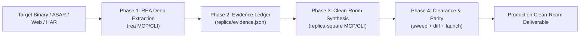

# REA: Reverse Engineer Anything (v6.8.0)

Reverse engineer compiled native binaries, Electron/JavaScript applications, Android packages, .NET assemblies, firmware, network captures, AgentEnv bundles, and crashes with verifiable evidence ledgers across 229 specialized tools.

---

## 1. Quick Start by Target Type

Before invoking tools, identify the target type and follow its dedicated pathway:

### A. Electron & JavaScript Applications (ASAR / `.js` bundles / Web)
* **Engine Required**: None (pure AST & static analysis).
* **MCP Tool**: `analyze_javascript_application` with `{ "target": "/path/to/app.asar" }` or `analyze_web_bundle`.
* **Deep Tracing**: `trace_application_feature` or `trace_javascript_semantics`.
* **Agent Environments**: Build local agent environments (`AgentEnv`) from network captures or live browser scenarios, then serve derived reads and evidence-gated writes.
* **CLI Fallback**:
  ```bash
  rea analyze-javascript-application /path/to/app.asar --json
  ```

### B. Bun Compiled Executables (`bun build --compile`)
* **Carrier**: Mach-O `__BUN,__bun`, PE/ELF `.bun` section, or appended trailer.
* **MCP Tool**: `open_binary` &rarr; `inspect_artifact` with `root_format: "bun-standalone"`.
* **Extraction**: `extract_artifact` extracts stored modules; analyze with `analyze_javascript_application`.

### C. Native Binaries (Mach-O, ELF, Windows PE)
* **Session Binding**: Active target requires binding first.
* **MCP Sequence**:
  1. `open_binary` with `{ "binary_path": "/path/to/executable" }`.
  2. `binary_overview` or `search_procedures` / `search_strings` to locate candidate seeds.
  3. `analyze_function` with `{ "procedure": "targetSymbol", "detail": "summary" }` (or `"detail": "complete"` for inline dossier).
  4. `xrefs` to inspect inbound call sites and reference flows.
* **CLI Fallback**:
  ```bash
  rea open-binary /path/to/executable
  rea function /path/to/executable --target "targetSymbol" --json
  ```

### D. Android APKs & Mobile Runtimes
* **Engine Required**: JADX / Java runtime.
* **MCP Sequence**:
  1. `inspect_android_package` with `{ "apk_path": "/path/to/app.apk" }`.
  2. `search_android_classes` &rarr; `inspect_android_class` &rarr; `inspect_android_method`.
* **CLI Fallback**:
  ```bash
  rea inspect-android-package /path/to/app.apk --json
  ```

### E. Firmware & Embedded Targets (ESP32 / Microcontrollers)
* **ESP Images & Flash**: `open_binary` &rarr; `inspect_artifact` (`esp-image` or `esp-flash-image`).
* **MCP Tool**: `inspect_firmware_regions` and `extract_firmware`.

### F. Web Network, API Captures & Browser Scenarios
* **Formats**: `.har` archives, mitmproxy flows, Playwright captures.
* **MCP Tool**: `inspect_web_network_capture` or `capture_browser_scenario`.

---

## 2. Invariants & Rules

1. **Evidence-First Invariant**:
   - Never speculate or hallucinate functionality. Every claim must cite concrete REA Evidence (artifact SHA-256 digest, virtual address offset, or demangled symbol).
2. **Summary-First Pattern**:
   - Start broad with overview tools (`binary_overview`, `inspect_artifact`, `search_procedures`). In REA 6.8.0, `analyze_function` defaults to retained summaries with on-demand drill-down via `inspect_analysis_view`.
3. **Graceful Engine Fallback**:
   - If a deep disassembler (Hopper / Ghidra / IDA) is not installed on the system, do not crash or stall. Fall back to static offline layout tools (`inspect_binary_layout`, `inspect_macho`, `inspect_plist`) or JavaScript AST tools.
4. **Bun-Native Execution**:
   - When executing CLI commands or scripts, always use the global `rea` binary or `bunx rea-agents`. Never invoke npm or Yarn.

---

## 3. Evidence Ledger & Feature Reconstruction

When asked to "reconstruct" or "build a version of" a feature found in a target app:

1. **Extract Core Logic**:
   - Locate the decompiled pseudocode or JS AST representation.
2. **Translate to Clean-Room Code**:
   - Convert compiler artifacts, mangled registers, and unrolled loops into clean, modern TypeScript or Rust.
3. **Attach Attribution & Evidence Ledger**:
   - Include a top-of-file header linking the implementation back to verified binary evidence:
   ```typescript
   /**
    * Feature Reconstruction: [Feature Name]
    * Reverse-Engineered from: [Target Binary / App Name]
    * Evidence Digest: sha256:1a82f...
    * Binary Location: 0x100004f20 (Method: SecurityManager.verifyToken)
    */
   ```
4. **Document Unknowns**:
   - Explicitly list external API dependencies or opaque cryptographic secrets that require runtime environment keys.

---

## 4. The Autonomous Dual-Engine Pipeline (REA + Replica-Square)

When a user asks to reverse-engineer and clone, reconstruct, or build an independent version of an application (or invokes `/rea` with product-rebuilding intent):
**Run as a fully autonomous, long-running agentic workflow from start to finish without pausing for human permission.**



### Execution Protocol:
1. **Phase 1: Deep Forensic Dissection (`rea`)**:
   - Use `analyze_javascript_application`, `inspect_artifact`, `open_binary`, `inspect_web_network_capture`, or `extract_artifact`.
   - Harvest raw endpoints, internal state shapes, AST routes, and data flows.
   - Hash all artifacts with SHA-256 digests.
2. **Phase 2: Evidence Handoff**:
   - Write harvested evidence into `replica/evidence.json` and initialize `replica/recon.md`.
3. **Phase 3: Autonomous Product Reconstruction (`replica-square`)**:
   - Execute dynamic routing: `replica-square route "<user prompt>"`
   - Synthesize production PostgreSQL DDL with RLS: `replica-square architect`
   - Generate WCAG 2.2 accessible Tailwind tokens: `replica-square design`
   - Run API mock server or contracts: `replica-square har` / `replica-square mock`
4. **Phase 4: Clean-Room Clearance & Parity**:
   - Perform strict brand/trademark AST sweep: `replica-square sweep` (Guarantee 0 proprietary leaks).
   - Evaluate 80/20 functional & visual parity: `replica-square diff`
   - Audit store listing metadata: `replica-square launch`
5. **Phase 5: Self-Verification**:
   - Verify every generated file exists on disk.
   - Output an executive clean-room delivery report with the evidence ledger attached.

---

## 5. Reference Documentation

- [`references/target-routing.md`](references/target-routing.md) &mdash; Complete tool mapping across 229 REA capabilities.
- [`references/cli-recipes.md`](references/cli-recipes.md) &mdash; Shell recipes for CLI reverse engineering.
- [`references/evidence-contract.md`](references/evidence-contract.md) &mdash; The JSON Evidence schema and reconstruction rules.
