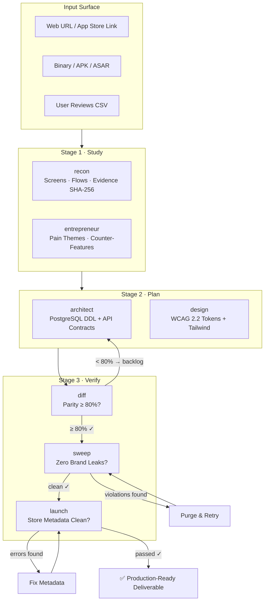

# Replica-Square: Fully Agentic Clean-Room Reconstruction Engine

> Point it at any app. It studies the original with verified evidence, plans a clean-room rebuild, checks every deliverable against deterministic gates, and clears all legal and store-listing preflight checks — autonomously.

---

## Execution Invariant

$$\text{Target} \xrightarrow{\text{SHA-256 Evidence}} \text{Recon Map} \xrightarrow{\text{Architect + Design}} \text{Build Spec} \xrightarrow{\text{Diff Gate}} \text{Parity \ge 80\%} \xrightarrow{\text{Sweep Gate}} \text{Clean Room} \xrightarrow{\text{Launch Audit}} \text{Shipped}$$

---

## The Seven Tools (Agents)

| Tool | CLI | Playbook | What it does |
|:---|:---|:---|:---|
| **recon** | `replica-square recon` | [`playbooks/recon.md`](playbooks/recon.md) | Maps screens, flows, data model, and evidence ledger |
| **entrepreneur** | `replica-square entrepreneur` | [`playbooks/entrepreneur.md`](playbooks/entrepreneur.md) | Mines user pain, ranks themes, formulates counter-features |
| **architect** | `replica-square architect` | [`playbooks/architect.md`](playbooks/architect.md) | Synthesizes PostgreSQL schema, API contracts, build order |
| **design** | `replica-square design` | [`playbooks/design.md`](playbooks/design.md) | WCAG 2.2 color validation, Tailwind token export |
| **diff** | `replica-square diff` | [`playbooks/diff.md`](playbooks/diff.md) | 80/20 feature-visual parity scoring |
| **sweep** | `replica-square sweep` | [`playbooks/sweep.md`](playbooks/sweep.md) | Trademark, domain, and hex-color clean-room sweep |
| **launch** | `replica-square launch` | [`playbooks/launch.md`](playbooks/launch.md) | App Store and Google Play metadata linter |

---

## Agentic Pipeline



---

## Three Constitutional Invariants

1. **Clean-Room Invariant**: Never copy source code, trademarks, assets, proprietary APIs, or copyrighted content. Study observable behavior and public contracts only.
2. **Evidence-First Invariant**: Every architectural claim cites a SHA-256 digest, URL, or DOM/network trace. Never speculate without evidence.
3. **Gate-Must-Pass Invariant**: The pipeline is blocked at parity < 80%, any sweep violation, or any store listing error. No exceptions.

---

## Quick Start

### Full Autonomous Pipeline
```bash
replica-square run --target "Calendly" --url https://calendly.com --fail-under 80
```

### Individual Tool Calls
```bash
replica-square recon https://app.example.com --out replica/
replica-square entrepreneur replica/reviews.csv
replica-square architect replica/recon-map.json
replica-square design replica/tokens.json
replica-square diff replica/features.csv --fail-under 80
replica-square sweep . --avoid "Competitor" --domains competitor.com --colors "#006bff"
replica-square launch replica/listing.json
```

### As MCP Server (for AI agents)
```bash
replica-square mcp
```

```json
{
  "mcpServers": {
    "replica-square": {
      "command": "/path/to/replica-square",
      "args": ["mcp"]
    }
  }
}
```

### Install via npx skills
```bash
npx skills add "https://github.com/imMamdouhaboammar/replica-square"
```

---

## Reference Index

| Path | Contents |
|:---|:---|
| [`playbooks/recon.md`](playbooks/recon.md) | Recon tool — step-by-step agent instructions |
| [`playbooks/entrepreneur.md`](playbooks/entrepreneur.md) | Entrepreneur tool — review mining and counter-feature synthesis |
| [`playbooks/architect.md`](playbooks/architect.md) | Architect tool — schema DDL and API contract generation |
| [`playbooks/design.md`](playbooks/design.md) | Design tool — WCAG 2.2 and token export |
| [`playbooks/diff.md`](playbooks/diff.md) | Diff tool — parity scoring methodology |
| [`playbooks/sweep.md`](playbooks/sweep.md) | Sweep tool — trademark clean-room certification |
| [`playbooks/launch.md`](playbooks/launch.md) | Launch tool — store metadata compliance |
| [`references/pipeline-state.md`](references/pipeline-state.md) | SOT state machine and artifact naming |
| [`references/evidence-contract.md`](references/evidence-contract.md) | Evidence schema, SHA-256 anchoring, REA compliance |
| [`references/parity-formula.md`](references/parity-formula.md) | 80/20 parity formula derivation and weighting |
| [`references/legal-boundaries.md`](references/legal-boundaries.md) | Clean-room legal scope and skip-row rules |
| [`evals/triggers.md`](evals/triggers.md) | Positive, negative, and pressure-test cases |
