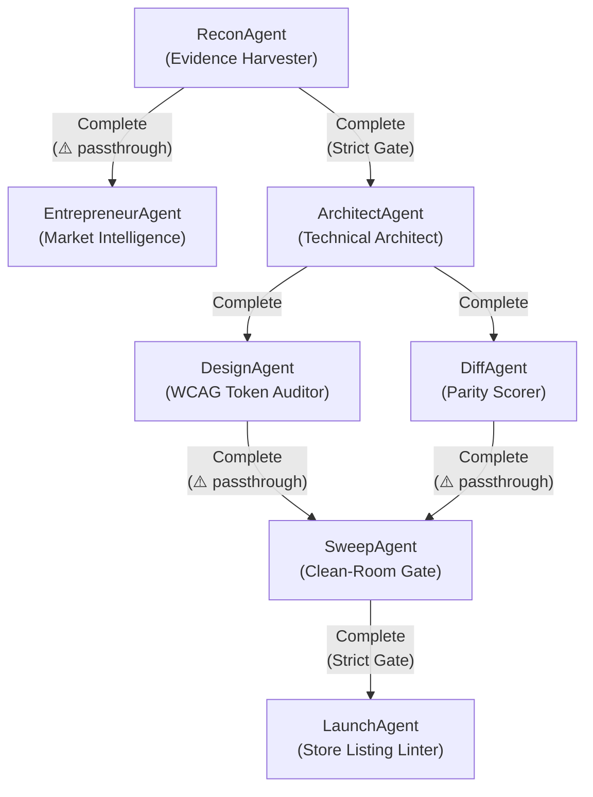

# Reference: Neural Connections & Signal Bus

## Topology & Inter-Agent Connections

Replica-Square models communication between its 7 tool-agents using a typed signal bus and a directed neural graph:



---

## Signal Protocol

Every tool-agent emits a `NeuralSignal` upon termination:

```json
{
  "from_agent": "recon",
  "event": "Complete",
  "payload": {
    "evidence_count": 75,
    "screen_count": 12
  }
}
```

### Signal Events

| Event | Node State | Meaning | Downstream Action |
|:---|:---|:---|:---|
| `Complete` | `NodeState::Complete` | Clean execution, all gates green | Downstream agents unblocked |
| `Warning` | `NodeState::Warning` | Non-fatal advisory (e.g. low parity, contrast alert) | Downstream unblocked if edge has `warning_passthrough = true` |
| `Failed` | `NodeState::Failed` | Critical failure (e.g. brand violation, DDL syntax error) | Downstream execution strictly blocked |
| `Skipped` | `NodeState::Skipped` | Gate artifacts already exist on disk | Downstream unblocked without re-execution |

---

## Warning Passthrough Rules

| Edge | Passthrough? | Rationale |
|:---|:---|:---|
| `recon → entrepreneur` | ✅ True | Lack of public reviews should not block general recon |
| `recon → architect` | ❌ False | Invalid recon map blocks database schema generation |
| `design → sweep` | ✅ True | WCAG contrast warning should not block trademark check |
| `diff → sweep` | ✅ True | Parity < 80% logs backlog but allows sweep to inspect code |
| `sweep → launch` | ❌ False | Any trademark violation strictly halts store deployment |

---

## Live Monitoring

The neural bus writes live state transitions to `replica/handoff-trace.md`:
- Current node state: `Idle`, `Running`, `Complete`, `Warning`, `Failed`, `Skipped`
- Timestamped signal log
- Active blocker inspection
